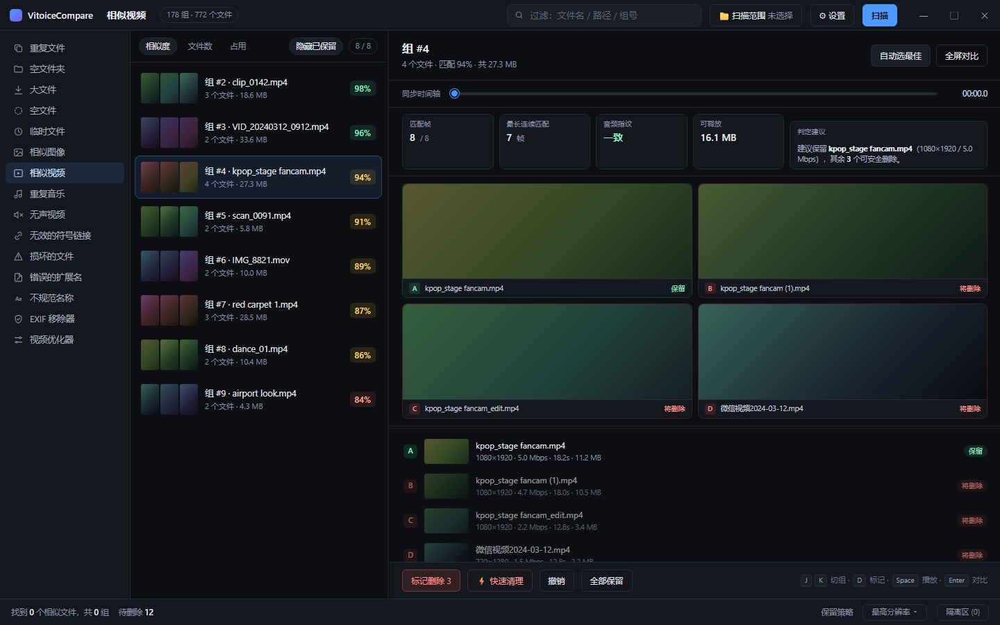
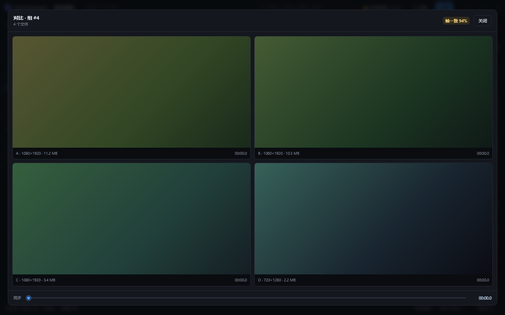
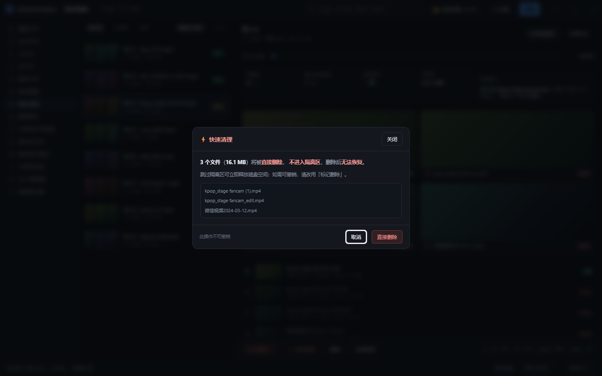

# VitoiceCompare

> 本地优先的视频 / 图片 / 音频素材去重与整理工具。扫描 → 同屏同步对比 → 保留最佳 → 清理副本，全程在本机完成。

[](https://github.com/lopezocern/vitoice-VI-compare)
[](https://tauri.app/)
[](LICENSE)

## 它解决什么问题

素材盘里经常堆着同一段视频的多个版本：原片、压缩版、微信转发版、剪辑版。逐个打开播放器对比既慢又容易删错。

VitoiceCompare 把「找出来 → 看清楚 → 做决定」放在同一屏：

- 找出画面高度相似的视频、图片、音频和重复文件；
- 把同一组的副本放在**同一个时间轴**上并排对比；
- 一键保留最佳版本，其余标记删除；默认先进隔离区，可撤销。

## 界面预览



| 全屏对比 | 快速清理确认 |
|:---:|:---:|
|  |  |

> 截图为演示数据，实际画面来自本地视频帧。

## 主要功能

- **15 个清理工具**：重复文件、空文件夹、大文件、空文件、临时文件、相似图像、相似视频、重复音乐、无声视频、无效符号链接、损坏的文件、错误的扩展名、不规范名称、EXIF 移除器、视频优化器。
- **同步对比网格**：同组所有副本同屏显示，拖动时间轴同步切换同一时刻画面；可拖动调整对比区高度，也可进入全屏对比。
- **保留策略**：自动选最佳（分辨率 × 码率 × 时长），也支持手动点选；`J` / `K` 切组、`D` 标记、`Space` 播放、`Enter` 全屏对比。
- **两级删除**：
  - **标记删除**：移动到隔离区，可按批次恢复或彻底删除；
  - **⚡ 快速清理**：直接物理删除，不进入隔离区，带重点提示的二次确认，删除后不可恢复。
- **执行型工具**：EXIF 元数据清理、视频压缩（社交分享 / 长期存档 / 极致压缩三档预设），原文件永不修改。
- **本地与隐私**：不联网、不上传；缩略图与哈希缓存目录、隔离区目录均可配置。

## 工具实现

| 工具 | 实现方式 |
|---|---|
| 重复文件 | 按大小预分组 → BLAKE3 全文件哈希 |
| 空文件夹 | 遍历目录，`read_dir` 为空 |
| 大文件 | 按大小降序取前 500 |
| 空文件 | `size == 0` |
| 临时文件 | 按扩展名与 `~` 结尾识别 |
| 相似图像 | 缩略图 + 64 位 pHash + 倒排候选 + 汉明距离 |
| 相似视频 | ffmpeg 抽帧（8–48 帧）+ 每帧 pHash + 时长分桶 + 连续匹配段 |
| 重复音乐 | 8 kHz RMS 包络 + 互相关，相似度 > 95% 且时长差 < 3% |
| 无声视频 | ffprobe 检测音轨；有音轨时首/中/尾抽样 `volumedetect`，峰值 ≤ -50 dB 视为静音 |
| 无效的符号链接 | `symlink_metadata` 成功但目标不存在 |
| 损坏的文件 | 视频 ffprobe 校验；图片尝试打开 |
| 错误的扩展名 | `infer` 读取魔术字节并与扩展名比对 |
| 不规范名称 | 首尾空格、点号结尾、多重扩展名、控制字符 |
| EXIF 移除器 | `-map_metadata -1 -c copy` 重新封装到 `_clean\` |
| 视频优化器 | 三档预设 + 队列执行，输出到 `_optimized\` |

## 环境要求

- Windows 10 / 11
- WebView2 运行时（Win10/11 通常自带）
- **`ffmpeg` 与 `ffprobe` 在 PATH 中**（抽帧、探测、音频指纹、EXIF 清理、视频转码都依赖，程序不内置）
- 从源码构建：Rust（MSVC target）、Tauri CLI 2

```powershell
cargo install tauri-cli --version "^2"
```

## 快速开始

```powershell
git clone https://github.com/lopezocern/vitoice-VI-compare.git
cd vitoice-VI-compare\app
.\run.ps1              # 开发版（debug，编译快、运行慢）
```

发布版与安装包：

```powershell
.\build-release.ps1    # 发布版，解码性能约为 debug 的 10 倍
.\build-installer.ps1  # 生成 Windows NSIS 安装包
```

构建产物目录由 `CARGO_TARGET_DIR` 控制。`run.ps1` 在本机存在 `G:\Code` 时会自动把构建产物放到工作区外，以避开某些沙箱 ACL 导致的 WebView2 启动失败；其他机器会使用默认的 `src-tauri\target`，也可以用环境变量自行覆盖。

## 使用流程

1. 顶栏「📁 扫描范围」选择包含目录（可多选）与排除目录，默认递归扫描；
2. 左侧选择工具，点击「扫描」；
3. 在左侧分组列表选择一组，右侧网格会并排显示所有副本；
4. 拖动「同步时间轴」对比同一时刻画面，点网格或文件行切换保留 / 删除；
5. 「标记删除」进入隔离区（可撤销）；确认无误后可在隔离区彻底删除，或使用「⚡ 快速清理」直接删除。

## 目录结构

```
app/
  web/index.html        前端单文件（内联 CSS / JS，无需构建）
  src-tauri/src/        Tauri 命令、扫描器、图像 / 音频 / 作业与缓存
  run.ps1               开发版启动脚本
  build-release.ps1     发布版构建
  build-installer.ps1   NSIS 安装包
docs/                   架构与设计文档
design/                 设计原型（不参与构建）
tools/                  行为对照用二进制（不参与构建、不随安装包分发）
```

## 文档

- [开发与架构说明](app/README.md)
- [架构文档](docs/ARCHITECTURE.md)
- [设计说明](design/DESIGN.md)
- [执行型工具设计](docs/DESIGN-JOBS.md)
- [扫描范围设计](docs/DESIGN-SCOPE.md)

## 安全说明

- 「标记删除」只是把文件移动到隔离区，可按批次恢复；
- 「⚡ 快速清理」会**直接物理删除、不进入隔离区、无法恢复**，操作前会弹出带重点标记的确认框；
- 视频优化器与 EXIF 移除器只写新的输出目录，不修改原文件；
- 建议首次使用时先小范围试扫，确认分组与保留策略符合预期。

## 参考与致谢

结果页交互与工具划分参考了 [Czkawka](https://github.com/qarmin/czkawka) / Krokiet，但本项目不依赖 `czkawka_core`，也不复制其源码；15 个工具均为独立实现。
抽帧、探测与转码依赖 [FFmpeg](https://ffmpeg.org/)。

## License

[MIT](LICENSE)
